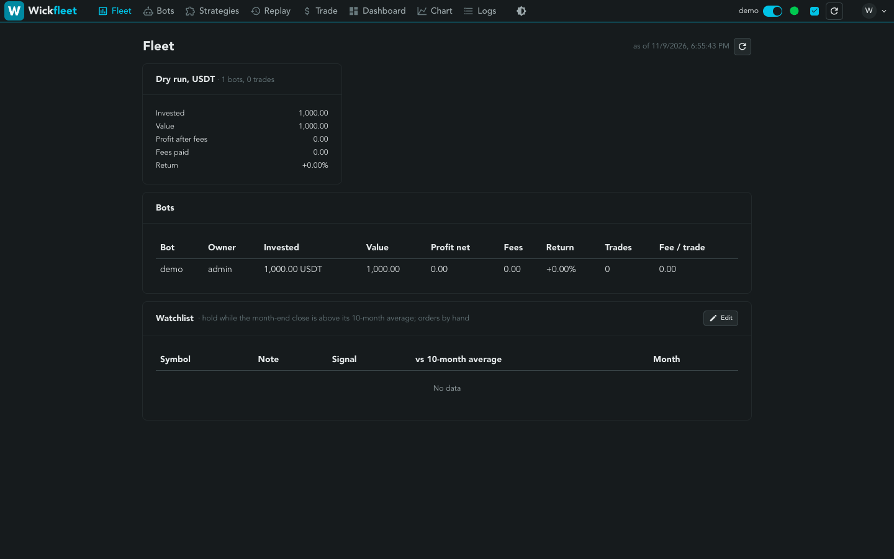
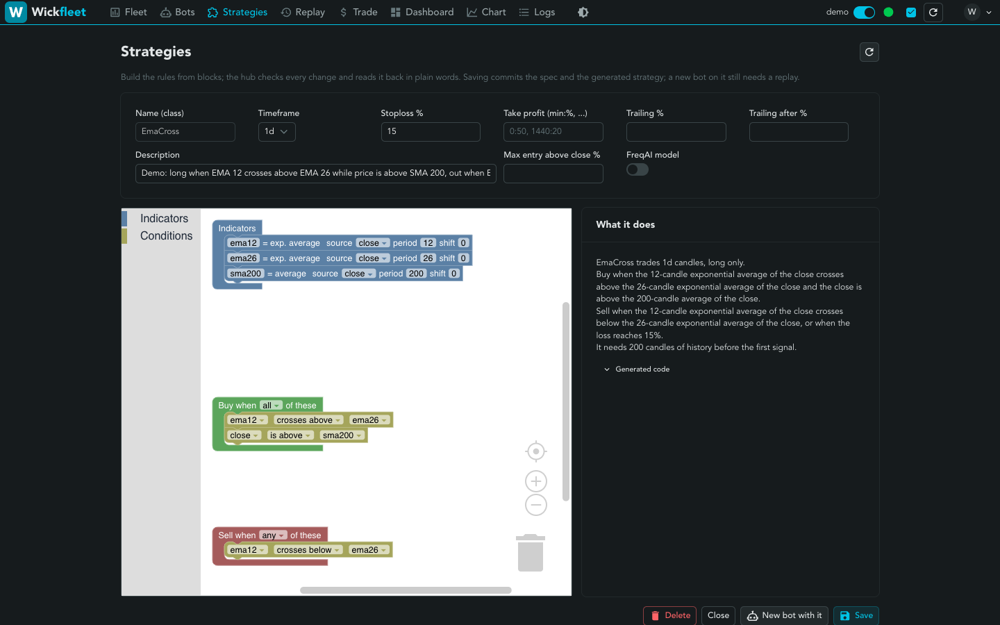
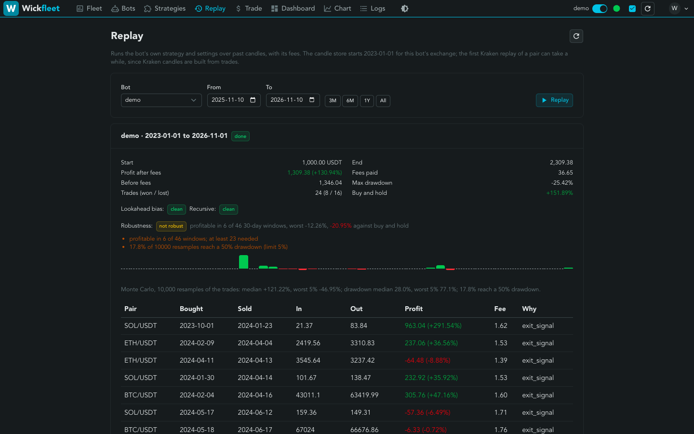
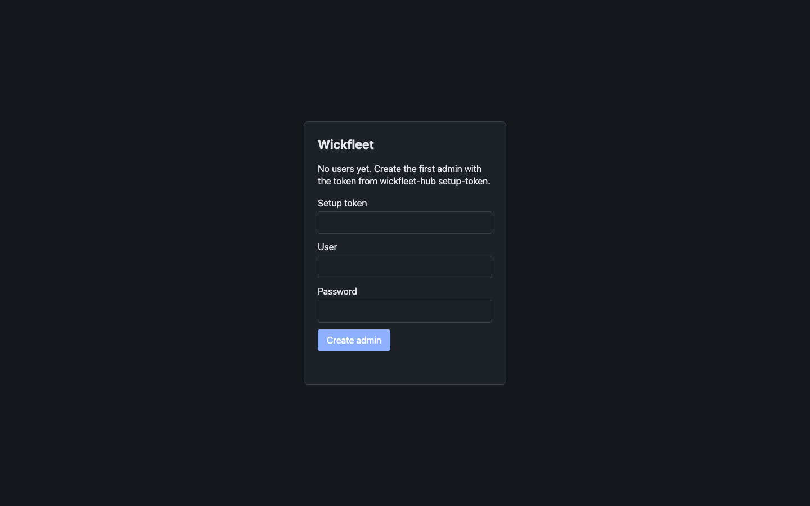
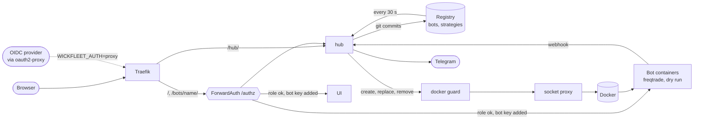

# Wickfleet

One browser UI for a fleet of [Freqtrade](https://www.freqtrade.io) bots. People
log in, through an OIDC identity provider or the hub's own login, and get a
role. Nobody handles a bot API password. Every bot runs in its own container
behind one origin. Strategies can be built from blocks instead of Python, and
every bot can be replayed over past candles, with lookahead and robustness
checks, before it starts.

This repository holds the **hub**: the one service between the reverse proxy
and the bots. The browser UI is a FreqUI fork in its own repository.

> Status: early. Bots run in dry-run mode by default. Not financial advice, see
> [Disclaimer](#disclaimer).



| Strategy from blocks, read back in plain words | Replay with bias checks and robustness verdict |
|---|---|
|  |  |

## Quick start

Needs Docker with Compose v2, git and make, on macOS or Linux. Everything runs
on one machine, bound to `127.0.0.1`.

```sh
make quickstart
```

| Step | What happens |
|---|---|
| Registry | `examples/registry` is copied to `deploy/compose/data/registry` and made a git repo. Bots and strategies saved in the UI become commits there |
| Stack | `deploy/compose/compose.yml` starts Traefik, the hub with `WICKFLEET_AUTH=builtin`, the UI, the docker guard and two socket proxies |
| Demo bot | the hub starts `demo`, a dry-run bot on the EmaCross example (BTC, ETH, SOL on Binance), within 30 s |
| First admin | the script prints a one-time setup token. Open <http://localhost:8000/hub/login>, enter it and create the user `admin`, who owns the demo bot |



Then open <http://localhost:8000/> for the fleet, `Replay` to backtest the demo
bot, `Strategies` to build one. `make quickstart-down` stops the stack and the
bots, data stays in `deploy/compose/data`.

| Variable | Default | |
|---|---|---|
| `WICKFLEET_PORT` | `8000` | local port |
| `WICKFLEET_ROOT` | `deploy/compose/data` | where registry, bot data, candles and state live |
| `WICKFLEET_HUB_IMAGE` | `ghcr.io/wickfleet/wickfleet-hub:latest` | set `wickfleet-hub:local` after `make image` to run your own build |
| `WICKFLEET_UI_IMAGE` | `ghcr.io/wickfleet/wickfleet-ui:latest` | or build it from the UI repository: `docker build -t wickfleet-ui:local <ui checkout>` |
| `WICKFLEET_FREQTRADE_IMAGE` | `freqtradeorg/freqtrade:2026.10`, pinned by digest | the only image a bot may run |

On Linux the stack runs as uid 1000, freqtrade's own user. With another uid,
`sudo chown -R 1000:1000 deploy/compose/data` once. A registry edited by hand
needs a commit before the hub can push its next change.

## How it fits



The hub reads the registry and reconciles the bot containers to it. Every
browser request for a bot or the UI passes `/authz` first, which checks the
role and ownership and adds the bot's API key, so the browser never holds one.
Login is either the hub's own (`builtin`, the quick start) or an OIDC provider
behind oauth2-proxy (`proxy`).

| Endpoint | Caller | Does |
|---|---|---|
| `/authz` | Traefik ForwardAuth, after oauth2-proxy | role from IdP groups, bot ownership, read vs write. Sets the bot's Basic key unless the request carries the bot's own JWT |
| `/hub/api/me` | UI | user and role |
| `/hub/api/fleet` | UI | per bot and totals: investment, value, profit net and gross, fees, fee per trade. Dry and live are never summed together |
| `/metrics` | Prometheus | the same figures as gauges |
| `GET /hub/api/bots` | UI | bots the caller may see, with `url` and `editable`, plus role and allowed image keys |
| `GET /hub/api/strategies` | UI | strategy files in the registry |
| `PUT /hub/api/bots/{name}` | UI, operators and admins | create or change a bot: one commit to the registry, applied after the next sync. With replay on, a new bot needs the caller's finished replay of the same settings from the last 7 days (412 otherwise). Edits are not gated. A managed bot (`arena:` set in the checkout or at the registry head) is refused for everyone (403). An instance may limit creation to admins |
| `DELETE /hub/api/bots/{name}` | UI, operators and admins | remove a bot by commit. Its data stays. Managed bots are refused (403): only their controller removes them |
| `/hub/api/reconcile` | admins | last reconcile pass: created, replaced, removed, errors |
| `/hub/api/signals` | UI | monthly signals for the watchlist: hold while the last month-end close is above its 10-month average |
| `GET /hub/api/watchlist` | UI | the watched symbols with notes, and whether the caller may edit them |
| `PUT /hub/api/watchlist` | UI, admins | replace the list: one commit of `watchlist.yaml`. Signals recompute after the next sync |
| `POST /hub/api/replays` | UI, operators and admins | backtest an existing `bot` or an unsaved `draft` (same fields as PUT) over `from`..`to`. 202 with a job id, 429 when 5 are queued |
| `GET /hub/api/replays` | UI | your replays (admins: all, plus candle store fetches) with state and summary |
| `GET /hub/api/replays/{id}` | UI | one replay. Trades once it is done |
| `GET /hub/api/specs` | UI | strategy specs in the registry: name, author, model, bots using it, editable |
| `GET /hub/api/specs/{Name}` | UI | one spec with its readback and generated code |
| `POST /hub/api/specs/check` | UI, operators and admins | validate a spec without saving: errors, or readback and code |
| `POST /hub/api/specs/draft` | UI, operators and admins | `{sentence}` -> 202 with a job id at once. One draft at a time (429), 4 min limit, never saves. A CPU draft outlasts the edge proxy's 50 s, hence the job |
| `GET /hub/api/specs/draft/{id}` | UI, the owner or an admin | running, failed with the reason, or done with the checked spec, readback, code and model. Kept 30 min |
| `PUT /hub/api/specs/{Name}` | UI, operators and admins | save a spec: one commit of `strategies/<Name>.json` and the generated `.py`. Anyone may add. The author or an admin may change, never while another user's bot runs it. A hand-written `.py` of that name is never overwritten. A spec a managed bot runs, or one by the instance's reserved author, is refused for everyone (403) |
| `DELETE /hub/api/specs/{Name}` | UI, author or admin | remove spec and code. Refused while a bot uses it, and for everyone on a managed spec (403) |
| `/hub/webhook/<bot>` | freqtrade webhooks, internal network only | forwards the text to one Telegram chat |
| `/healthz` | container runtime | registry loaded |

## Login

| `WICKFLEET_AUTH` | Who says who you are |
|---|---|
| `proxy` (default) | oauth2-proxy in front of the hub (any OIDC provider, e.g. Kanidm). The hub reads its `X-Auth-Request-*` headers. Roles come from IdP groups, below |
| `builtin` | the hub itself: local users in `users.json` in the state dir, argon2id hashes, one role each. Client `X-Auth-Request-*` headers are dropped and `WICKFLEET_ROLE_GROUPS` is ignored |
| `demo` | nobody: a public read-only instance. Every visitor is the viewer `demo` and sees the bots with `owner: demo`. Client `X-Auth-Request-*` headers are dropped, the hub answers only GET, HEAD and OPTIONS (403 otherwise), and bot calls pass ForwardAuth only as reads plus the FreqUI token login. Live trading stops the hub |

Built-in login:

| | |
|---|---|
| First admin | `wickfleet-hub setup-token` (in the hub container) prints a one-time token, valid 1 h. Open `/hub/login`, which asks for it while no user exists. There is no default user or password |
| More users | `wickfleet-hub user add <name> <viewer\|operator\|admin>` with the password on stdin, `user del <name>`, `user list`. A running hub picks the change up at once, sessions included |
| Session | cookie `wickfleet_session`: `Secure`, `HttpOnly`, `SameSite=Strict`, 12 h from login, kept in memory (a restart signs everyone out) |
| Sign out | `/hub/login?signout` |
| CSRF | login, logout, setup and every API write need `X-Wickfleet-Request: 1`. A write the browser marks `Sec-Fetch-Site: cross-site` carries no identity, bot API calls through `/authz` included |
| Rate limit | 5 failed logins per user and address, 20 per address, in 15 min, then 429 with `Retry-After`. The address is the last `X-Forwarded-For` hop (the edge proxy's view), else the peer |
| Edge | Traefik ForwardAuth to `/authz` as with the proxy, minus oauth2-proxy. A browser without a session that opens a page is sent to `/hub/login` and back |

| Route | Does |
|---|---|
| `GET /hub/login` | the login page (and the first-admin form while no user exists) |
| `POST /hub/auth/login` | `{"user", "password"}`: sets the session cookie. 401 for any wrong pair, 429 while locked |
| `POST /hub/auth/logout` | ends the session |
| `POST /hub/auth/setup` | `{"token", "user", "password"}`: the first admin, once. 409 once a user exists, 403 without a valid token |
| `GET /hub/auth/me`, `GET /hub/auth/state` | who is signed in (401 if nobody). Whether setup is pending |

## Security model

| Concern | How |
|---|---|
| Who you are | `builtin`: the hub's own users, argon2id hashes, session cookie. `proxy`: oauth2-proxy in front, the hub trusts its headers only next to the shared `X-Wickfleet-Authz-Key`. Client copies of identity headers are dropped in both modes |
| What you may do | roles viewer, operator, admin. Operators see and change only their own bots, admins all. Every write needs `X-Wickfleet-Request: 1` |
| Bot API keys | made by the hub per bot, added by `/authz` per request, never sent to the browser |
| Docker | the hub reaches Docker only through `wickfleet-dockerguard`, which allows only bot containers of listed images, users, networks and bind paths, with all capabilities dropped. See [Docker guard](#docker-guard) |
| Real money | off by default. Every bot is a dry run unless the instance sets `WICKFLEET_LIVE_TRADING=true`, the bot sets `dry_run: false`, and a replay of exactly those settings from the last 7 days passed the bias checks and the robustness verdict. Exchange keys come only from files on the host (`WICKFLEET_EXCHANGE_KEYS_DIR`), never from the registry or the UI |
| Strategy code | specs generate Python from a whitelist, so no typed text reaches the code. A hand-written `.py` in the registry runs as is: review it like any code you run |

Reporting a vulnerability: [SECURITY.md](SECURITY.md).

## Roles

| IdP group | Can |
|---|---|
| `trade_viewers` | read own bots |
| `trade_operators` | read and change own bots |
| `trade_admins` | everything, every bot |

Group names are matched on the part before `@`, so `trade_admins@idm.example.org` counts.
`WICKFLEET_ROLE_GROUPS` replaces the three, e.g. `players=viewer,admins=admin`.

## Config

| Env | Default | |
|---|---|---|
| `WICKFLEET_LISTEN` | `:8090` | |
| `WICKFLEET_AUTH` | `proxy` | `proxy`, `builtin` or `demo`, see Login. Anything else stops the hub |
| `WICKFLEET_LIVE_TRADING` | unset | `true` lets a bot set `dry_run: false` and trade real money. Off, any live bot is refused at the API, at registry load and at render |
| `WICKFLEET_EXCHANGE_KEYS_DIR` | unset | required with live trading: `<bot>.json` holding `{"key":"...","secret":"..."}`, a regular file, mode 0600 or 0400. The only source of exchange keys |
| `WICKFLEET_REGISTRY_DIR` | `/registry` | one `<bot>.yaml` per bot |
| `WICKFLEET_SECRETS_DIR` | `/secrets` | `<bot>.api.password` per bot |
| `WICKFLEET_BOT_URL` | `http://bot-%s:8080` | `%s` is the bot name |
| `WICKFLEET_TELEGRAM_TOKEN_FILE` | unset | file holding the bot token |
| `WICKFLEET_TELEGRAM_CHAT_ID` | unset | set both, or notifications are dropped |
| `WICKFLEET_CANDLE_DIR` | unset | host path of the shared candle store, `<exchange>/` each. Set it (with `WICKFLEET_DOCKER`) to turn replay on |
| `WICKFLEET_REPLAY_DIR` | `/var/lib/wickfleet/state/replays` | host path, one dir per job: config, strategy copy, result, trades |
| `WICKFLEET_REPLAY_SINCE` | `2025-01-01` | the store holds candles from this day. Replays cannot start earlier. Per exchange: `2020-01-01,kraken=2025-01-01` (Kraken builds candles from trades, so deep history is slow there). Each pair and timeframe carries a `.wickfleet-since-<PAIR>-<tf>` marker. When one is missing or later than the start, the job first runs `download-data --prepend` |
| `WICKFLEET_REPLAY_MEM_MB` / `_FREQAI_MEM_MB` | `1536` / `3072` | memory cap per replay container |
| `WICKFLEET_DRAFT_OLLAMA` / `_MODEL` | unset | Ollama base URL and model tag for drafting specs from a sentence |
| `WICKFLEET_DRAFT_ANTHROPIC_KEY_FILE` / `_MODEL` | unset / `claude-opus-5-5` | optional second drafting provider, tried after Ollama |
| `WICKFLEET_SIGNALS` | unset | fallback watchlist, comma list of Yahoo symbols, used only while the registry has no `watchlist.yaml` |
| `WICKFLEET_SIGNAL_ACCOUNT` | unset | `taxable`: a flip asks to stop or resume buying, never to sell (every sale realizes gains). Unset: BUY/SELL |
| `WICKFLEET_SIGNAL_PARKING` | unset | where new money goes while a fund is OUT, e.g. `CLF` |
| `WICKFLEET_STATE_DIR` | `/state` | holds `signals.json`, the last month reported |
| `WICKFLEET_ROLE_GROUPS` | `trade_viewers=viewer,trade_operators=operator,trade_admins=admin` | IdP group to role, `group=role,...` |
| `WICKFLEET_AUTHZ_KEY_FILE` | unset | secret the proxy sends as `X-Wickfleet-Authz-Key`. Required on `/authz` and `/hub/api/` when set |
| `WICKFLEET_METRICS_LISTEN` | unset | separate listener (e.g. `:9108`) serving only `/metrics`. The main one then drops it |
| `WICKFLEET_DOCKER` | unset | Docker API (a socket proxy) for reconcile. Unset = the hub only reads |
| `WICKFLEET_IMAGES` | unset | `key=ref,...`. The only images a bot may use, by key |
| `WICKFLEET_DATA_DIR` | `/var/lib/wickfleet/bots` | host path, `<bot>/` is freqtrade user_data |
| `WICKFLEET_BOT_STATE` | `/var/lib/wickfleet/state` | host path, per-bot config, strategy copy and secrets |
| `WICKFLEET_NETWORK` | `wickfleet_edge` | network shared with Traefik and the hub |
| `WICKFLEET_HOST`, `WICKFLEET_UI_BOT` | unset | Traefik host rule, and the bot that serves FreqUI at `/` |
| `WICKFLEET_BOT_USER` | `1000:1000` | uid:gid inside bot containers |
| `WICKFLEET_REGISTRY_WRITE_URL` | unset | registry repo for writes (ssh). Unset = the bot API is read-only |
| `WICKFLEET_REGISTRY_WRITE_KEY`, `WICKFLEET_REGISTRY_KNOWN_HOSTS` | unset | deploy key with write access to that repo only, and its pinned host keys |
| `WICKFLEET_REGISTRY_WORKDIR` | `/var/lib/wickfleet/state/registry-rw` | the hub's working clone |

Writes need the header `X-Wickfleet-Request: 1` (a custom header forces a CORS
preflight, so another site cannot send one with the user's cookie) and a JSON
body. Unknown fields are refused. Operators always own what they create. Only
admins set `owner`. The body goes through the same loader the reconciler
uses, against the real defaults and strategies, before anything is committed.

## Reconcile

With `WICKFLEET_DOCKER` set, the registry is the desired state: every 30 s the
hub writes each bot's config and strategy, then creates, replaces (spec hash
changed) or removes containers labelled `wickfleet.managed=hub`. It never
touches other containers. Bots run dry, with all capabilities dropped, no new
privileges and fixed binds. An image is picked by key from `WICKFLEET_IMAGES`,
never from the registry. A bot that fails to prepare keeps its old container.

Signals place no orders. They are for markets the hub cannot trade, such as
ETFs at a broker without an order API. A person places the order.

A registry is a directory with `defaults.yaml` (keys every bot inherits),
`bots/<name>.yaml` and `strategies/`. A flat directory of `<name>.yaml` works too. A bot file:

```yaml
name: ma            # [a-z][a-z0-9-]{0,30}, same as the file name
owner: alice        # IdP user, part before @
strategy: DryRun
exchange: kraken
pairs: [BTC/USDT, ETH/USDT]
stake_currency: USDT
wallet: 1000
max_open_trades: 3
dry_run: true       # default true, false needs WICKFLEET_LIVE_TRADING=true
```

An optional `watchlist.yaml` next to `bots/` lists what the signals watch.
Any Yahoo Finance symbol: ETFs and stocks (`XIC.TO`), crypto (`BTC-USD`), FX
(`CADUSD=X`), indices (`^GSPC`). At most 50. Admins edit it in the UI.

```yaml
symbols:
  - symbol: XIC.TO
    note: Canada core   # optional, 80 characters
  - symbol: BTC-USD
```

## Docker guard

`wickfleet-dockerguard` (same image, second entrypoint) runs between the hub
and the socket proxy. The hub only reaches Docker through it. The socket proxy
filters by endpoint, the guard by request body:

| Request | Allowed when |
|---|---|
| `GET` container list, inspect, logs, `/_ping`, `/version` | always |
| `POST /containers/create` | name starts `wickfleet-`, image in `WFGUARD_IMAGES`, user in `WFGUARD_USERS`, label `wickfleet.managed`, `CapDrop` has `ALL`, `SecurityOpt` is exactly `no-new-privileges:true`, network in `WFGUARD_NETWORKS`, every bind source a clean path under `WFGUARD_BIND_PREFIXES`, `CpuShares`, if set, 2 to 1024 (a lower weight than the bots, never higher). No other field (keys compared case-insensitively, a key twice is refused) |
| `POST /images/create` | the ref is in `WFGUARD_IMAGES` |
| `POST .../start`, `DELETE /containers/{id}` | the container carries `wickfleet.managed` |
| anything else (exec, update, archive, build, networks, volumes) | never |

| Variable | Example |
|---|---|
| `WFGUARD_UPSTREAM` | `http://socket-proxy-hub:2375` |
| `WFGUARD_LISTEN` | `:2375` (default) |
| `WFGUARD_IMAGES` | the pinned refs from `WICKFLEET_IMAGES`, comma-separated |
| `WFGUARD_BIND_PREFIXES` | `/var/lib/wickfleet/bots/,/var/lib/wickfleet/state/,/var/lib/wickfleet/candles/` |
| `WFGUARD_NETWORKS` | `wickfleet_edge` |
| `WFGUARD_USERS` | `1000:1000` |

Refusals are logged with the reason and answered 403. The reconcile and replay
tests feed every spec the hub builds through the guard, so a hub change that
the guard would block fails in CI.

## Replay

A replay runs two short-lived containers on the bot's own image: `download-data`
appends to the candle store from `WICKFLEET_REPLAY_SINCE`, then `backtesting`
over the range. The bot's real config is used, so fees and stake match the bot.
Kraken has no candle history: its store is built from trades, about 50 s per
pair and week the first time, incremental after. The hub refreshes the store for
every exchange, pair and timeframe the bots use two minutes after start and then
daily, so replays usually find their data ready. One replay and one fetch run at
a time, never two on the same exchange. freqtrade exits 0 on some fatal errors,
so a step fails on any `ERROR` log line too.

After the backtest, two more steps run freqtrade's `lookahead-analysis`
(at least 5 trades) and `recursive-analysis` on the same data. A lookahead bias
blocks a new bot with those settings. Too few trades or recursive variance
(drift above 0.1% at the strategy's own startup) are shown as warnings. FreqAI
bots skip both: the analysis would retrain the model per signal.

Every replay also gets a robustness verdict from its trades, no extra run:

| Check | Pass rule (defaults, `replay.Rules`) |
|---|---|
| Walk-forward windows | the range splits into 30-day windows ending at `to`. At least 6 |
| Total | net profit over the replay above 0 |
| Consistency | at least half the windows profitable |
| Worst window | no window below -15% |
| Monte Carlo | 10,000 resamples of the trades (seeded by the job id). At most 5% reach a 50% drawdown. Under 20 trades it is shown, not judged |

Shown, not judged: profit against buy-and-hold of the pairs, median and
worst-5% drawdown and return. A failed verdict warns on a dry-run bot. It is
the gate for live trading: saving a bot with `dry_run: false`, new or edited,
needs a replay of exactly those settings from the last 7 days that passed the
bias checks and this verdict. A replay always runs on paper, even for a live bot.

`internal/replay/integration_test.go` runs a real replay. It needs a socket
proxy like production's and a dir Docker can bind:

```sh
docker run -d --name wf-it-proxy -p 127.0.0.1:23750:2375 -v /var/run/docker.sock:/var/run/docker.sock:ro -e CONTAINERS=1 -e IMAGES=1 -e POST=1 tecnativa/docker-socket-proxy:v0.4.1
WICKFLEET_IT_DOCKER=http://127.0.0.1:23750 WICKFLEET_IT_DIR=$(mktemp -d) WICKFLEET_IT_USER=1000:1000 go test ./internal/replay -run Integration -v
```

## Strategy specs

A strategy can be written as a small JSON spec instead of Python
(`internal/strategy`): spot, long only, one timeframe, indicators from a
whitelist (sma ema tema highest lowest rsi atr adx bollinger macd stoch),
conditions `>` `<` `>=` `<=` `crosses_above` `crosses_below` `rising`
`falling`, one level of `all` or `any`, stoploss, time ROI and trailing.
Every name is checked against a strict pattern and numbers are formatted by
the generator, so no typed text reaches the Python. A readback states the rules
in plain words. `Spec.Columns` computes the generated strategy's columns in Go
with the arithmetic of pandas and TA-Lib 0.8.1, for charts and trade reasons.
It is tested against freqtrade 2026.9 running the generated `AllKinds` strategy
(`testdata/columns.golden.json`, regenerated by `make strategy-golden`, needs docker).
`make equivalence` backtests the demo specs in `examples/registry` against
hand-written twins and checks they make the same trades (see
[examples](examples/README.md)).

A spec can add a FreqAI model: `model` picks the fixed `freqai_example` feature
set (selection follows freqtrade's FreqAI example) and the `mean_return` target,
which makes the operands `prediction` and `do_predict` available. `==` compares
against a number. `startup_candles` is required, since the feature windows live
in the bot's FreqAI config. `entry_guard.max_above_close` refuses a buy filled
too far above the last close. `testdata/FreqaiExample.json` pins the generated
FreqAI source in a golden file.

```sh
make build
bin/wickfleet-strategy describe examples/registry/strategies/EmaCross.json
bin/wickfleet-strategy gen examples/registry/strategies/EmaCross.json > EmaCross.py
```

## Drafting from a sentence

`internal/drafter` asks a model for a spec. The model only proposes JSON.
Output is constrained by an ordered JSON schema with one variant per indicator
kind and condition form, then `strategy.Parse` decides. A rejected draft goes
back once with the validation error. Ollama runs with thinking off, a 1200-token
cap and an 8k context. The Anthropic provider asks for a `submit_spec` tool
call (current models refuse a forced `tool_choice`). A schema with a union at
the top travels in one `answer` field, since a tool input must be an object.
Pick a model with the eval:

```sh
bin/wickfleet-strategy eval -ollama http://host:11434 -model a,b internal/drafter/testdata/eval.json
```

## Develop

`make` lists the targets. `make setup lint test vuln` runs what CI runs.
See [CONTRIBUTING.md](CONTRIBUTING.md) and [CODE-GUIDELINES.md](CODE-GUIDELINES.md).

## Disclaimer

Wickfleet is software for running trading bots, not financial advice. Nothing
in this repository, the examples included, is a recommendation to buy or sell
anything. Backtests and replays describe the past, not the future. Bots run as
dry runs on a simulated wallet by default. Turning on live trading is your
decision, with your exchange keys, your money and your risk. The software comes
with no warranty, see the licence.

## Licence

Copyright (C) 2026 Daniel Humpf. Licensed under the GNU General Public License
v3.0, see [LICENSE](LICENSE). It comes with no warranty.
`examples/registry/strategies/SampleStrategy.py` is freqtrade's sample
strategy, also GPL-3.0. Contributions are signed off under the DCO, there is no
CLA, see [CONTRIBUTING.md](CONTRIBUTING.md).
